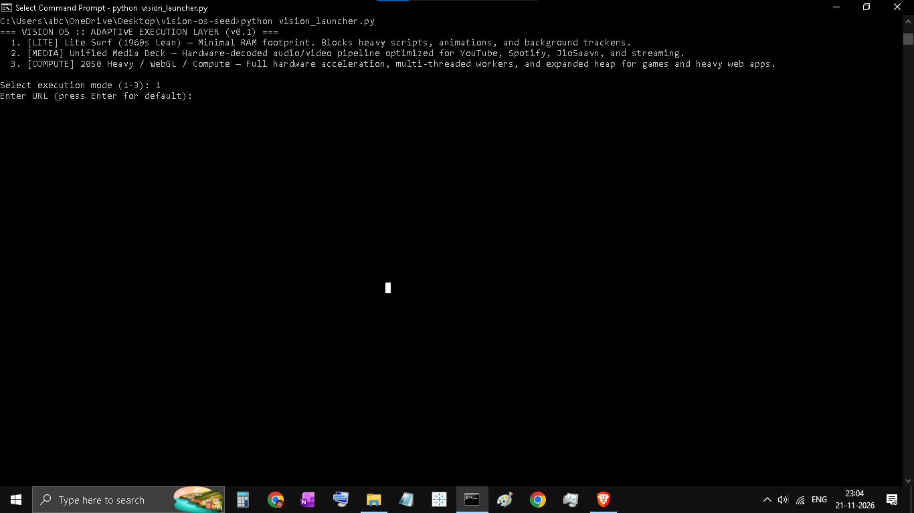
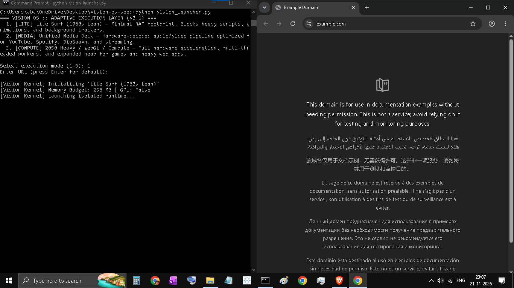
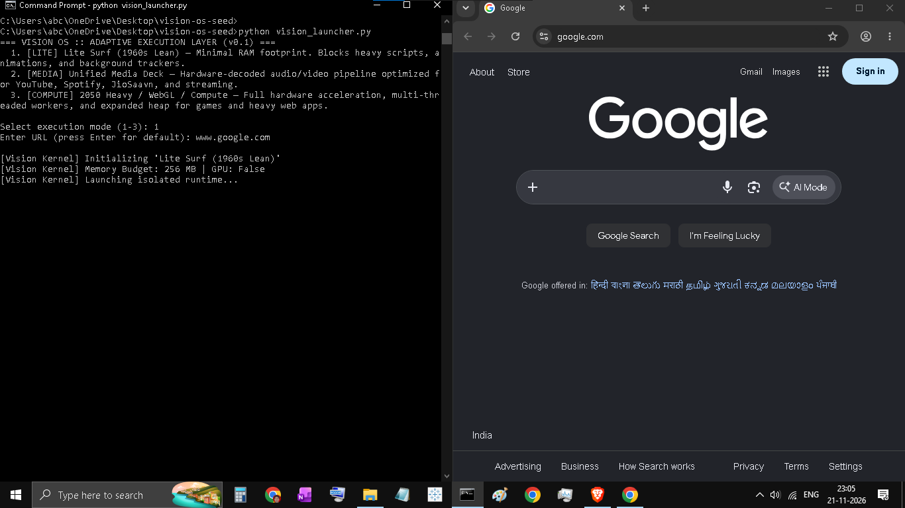
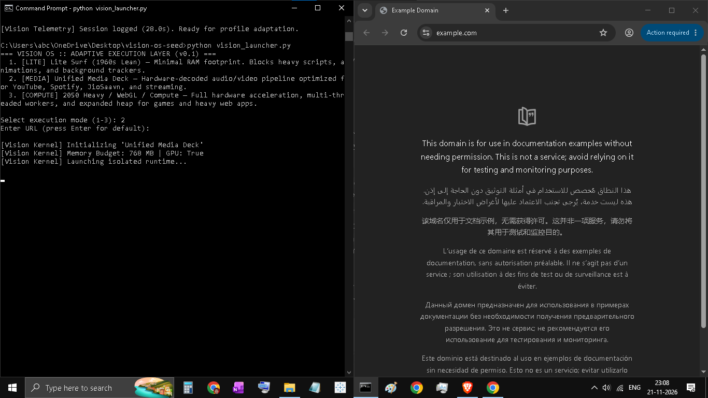

# Vision OS (v0.2)

**Lean 1960s Core Philosophy. Adaptive 2050 Execution & Hybrid Compute.**

Vision OS is an open-source, lightweight desktop environment and adaptive runtime built to stay fast on modest hardware. Instead of forcing every task onto a single heavy local loop, Vision separates a lean desktop shell and native micro-apps from adaptive browser/media profiles, custom user apps, and offloaded/local AI reasoning.


## What's Inside v0.2
- **Floating Water-Bubble Desktop (`vision_os.py`):** Fullscreen/windowed desktop canvas with animated app nodes and a minimal bottom taskbar (`Esc` toggles fullscreen).
- **Built-In Core Tools:** Adaptive Browser (*Lite Surf*, *Media Mode*, *Heavy Mode*), Unified Media Hub, Vision Paint, Notepad, Clock/Stopwatch/Timer, and Hardware/Connectivity quick controls.
- **Custom App & Service SDK (`vision_sdk.py`):** Create and launch lightweight user micro-apps inside `vision_apps/` with manifest metadata.
- **Vision AI & Telemetry Loop:** Tracks session activity in `vision_telemetry.jsonl`, auto-tunes profile memory caps in `profiles.json`, and supports lightweight local + offloaded cloud/distributed compute routing.
- **Bootable ISO Builder (`build_vision_iso.sh`):** Generates a bootable `.iso` image for VM testing or USB live booting without altering your Windows partition.


# Vision OS (Seed v0.1)

**Lean 1960s Kernel Philosophy. Adaptive 2050s Execution.**

Vision OS is an open-source, modular operating system and runtime layer built around one core thesis: **software should scale its resource footprint to match user intent, not exhaust low-end hardware by default.**

## Core Pillars
1. **Intent-Driven Runtimes:** Applications declare resource profiles (*Lite Surf*, *Media Deck*, *Heavy Compute*) before launch rather than loading monolithic engines upfront.
2. **Windows-Familiar, Decoupled Shell:** Clean, low-overhead desktop UX separated from core system services so 2–4 GB RAM machines stay fast.
3. **Unified Media & Web Layer:** Single lightweight shell unifying local and web media workflows without multi-tab bloat.
4. **Feedback-Driven Self-Tuning:** Telemetry-guided profile optimization with immutable, roll-backable system layers.






## Quickstart (Seed Prototype)
```bash
git clone [https://github.com/](https://github.com/)VijayRDS/vision-os-seed.git
cd vision-os-seed
python3 vision_launcher.py

